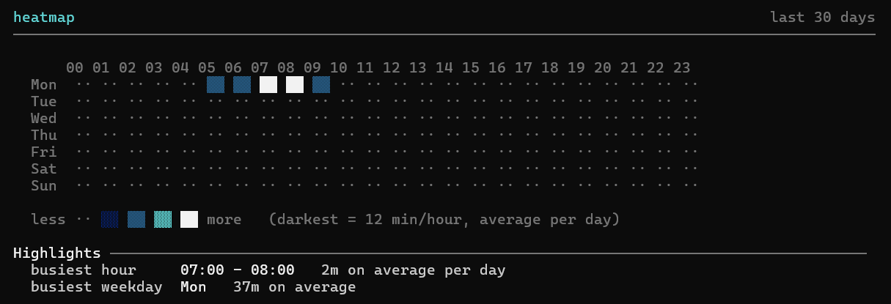
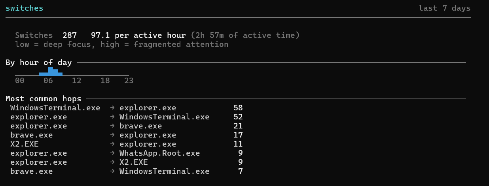
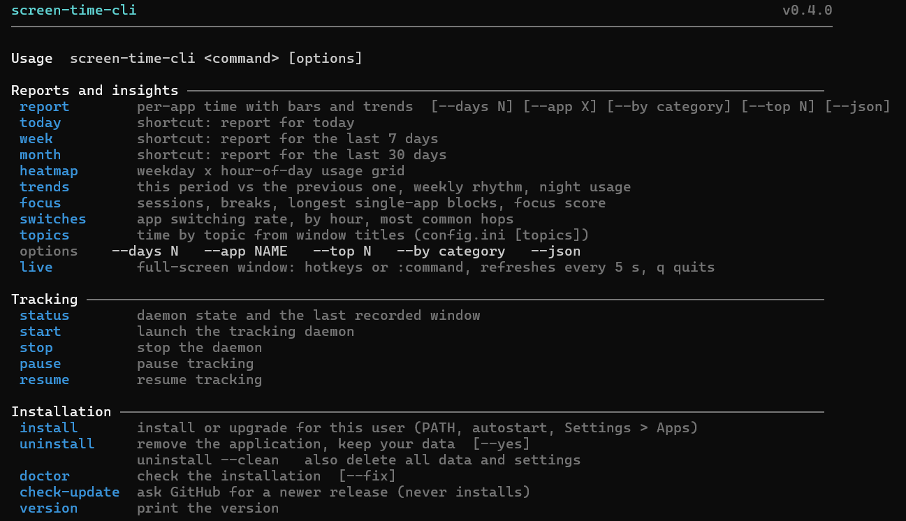

# screen-time-cli

Tiny terminal-only screen-time tracker for Windows. A hidden background daemon records the foreground app and window
title (event driven, near-zero CPU) into a local SQLite file; the CLI reads it. Nothing leaves the machine.

**Install without cloning**, paste into PowerShell (no admin needed):

```powershell
irm https://raw.githubusercontent.com/Akkshatttt/screen-time-cli/main/install.ps1 | iex
```

Then open a new terminal and run `screen-time-cli today`.

<p align="center"></p>

## Screenshots
The weekly report: time per app with active/passive bars, daily totals and hour of day.


The weekday x hour heatmap shows when you are at the screen.



App switching: how fragmented your attention is, by hour, and the most common hops.



Every command and option:



## Build
MinGW gcc: `mingw32-make all test`. Produces `build/screen-time-cli.exe` and `build/screen-time-daemon.exe`.

## Install (per user, no admin)
`build\screen-time-cli.exe install` copies both exes to `%LOCALAPPDATA%\Programs\screen-time-cli`, adds it to your user
PATH, starts the daemon at logon, and lists the app in Settings > Apps. `screen-time-cli uninstall` removes the application and keeps your data; `uninstall --clean` removes everything.

## Upgrading
Build or download the new version, then run `install` from it. The old files are kept until the new daemon is confirmed
running and restored automatically if anything fails. Your data lives in `%LOCALAPPDATA%\screen-time-cli` and is never
touched by upgrades. Databases are migrated in place after a backup (`data.db.bak-v<N>`).

## Commands
| Command | Does |
|---|---|
| `status` | daemon state and last recorded window |
| `today` | the day so far: pace against yesterday at the same time, what is running now, an hourly strip by category, top apps, attention |
| `report` | dashboard over the last 7 days (fewer if less is recorded): plain-language findings, scores (focus, fragmentation, variety, consistency), category mix, when each category peaks, focus by category, unusual days and apps. Options: `--days N`, `--app NAME`, `--by category`, `--top N`, `--json` |
| `week` / `month` | per-app bars with trends and daily totals (same options) |
| `export [spans\|daily]` | dump data as CSV or JSON: `--days N`, `--format csv\|json`, `--out FILE` (never overwrites) |
| `label` | name an app and assign it a category or topic: no arguments = numbered picker; `label <exe> [name] [--category C] [--topic T]`; `label --clear <exe>`. Saved in `labels.ini` (the program owns that file; `config.ini` stays yours) |
| `heatmap` | weekday x hour-of-day usage grid |
| `trends` | this period vs the previous one, weekly rhythm, late-night share |
| `focus` | sessions, breaks, longest single-app blocks, focus score |
| `switches` | app switching rate, by hour, most common hops |
| `topics` | time by topic from window titles |
| `live [view]` | full-screen window; each view replaces the last and refreshes every 5 s. Keys: `t` today, `r` report, `w` week, `m` month, `h` heatmap, `e` trends, `f` focus, `s` switches, `o` topics, space refresh, `:` command line (e.g. `:report --days 14 --app chrome`), arrows / PgUp / PgDn / Home / End scroll a view taller than the window, `q` quit. Your shell screen is restored on exit |
| `start` / `stop` / `pause` / `resume` | control the daemon |
| `install` | per-user install or in-place upgrade |
| `uninstall` | remove the application, keep your data (asks y/N; `--yes` skips) |
| `uninstall --clean` | also delete all data: database, backups, `config.ini` |
| `doctor [--fix]` | check the installation, optionally repair it |
| `check-update` | ask GitHub whether a newer release exists (never installs) |
| `version` | print version |

Output is colored with Unicode bars in a console and plain ASCII when piped; set `NO_COLOR` to turn color off. Every
report takes `--json` for scripts. Categories and topics come from `config.ini` in the data folder, for example:

    [categories]
    Work=Code.exe,WINWORD.EXE
    [topics]
    YouTube=youtube
    Mail=gmail|outlook

Time is split into active (recent input), passive (no input but fullscreen or audio playing) and away (idle 10 min,
locked, asleep; not counted). Optional `config.ini` in the data folder: `[tracking]` `active_seconds`, `away_seconds`,
`heartbeat_seconds`.
